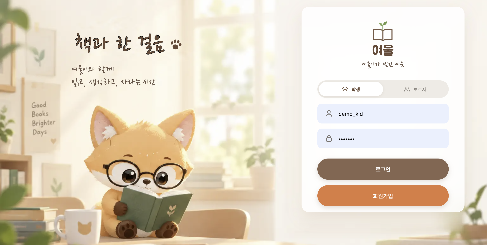
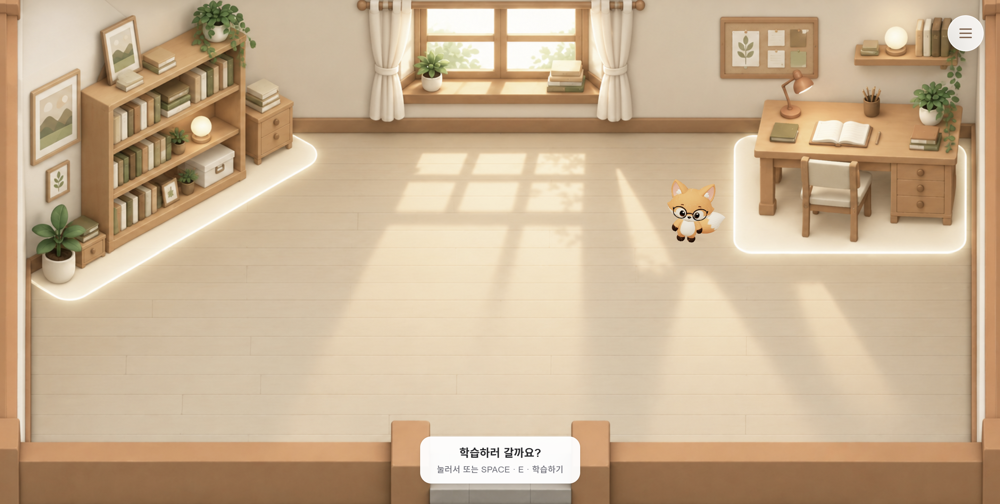
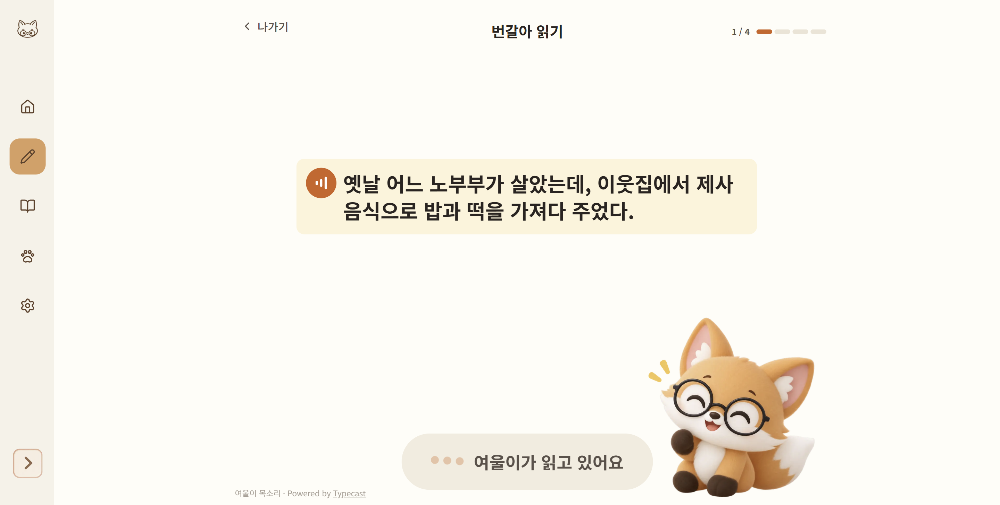
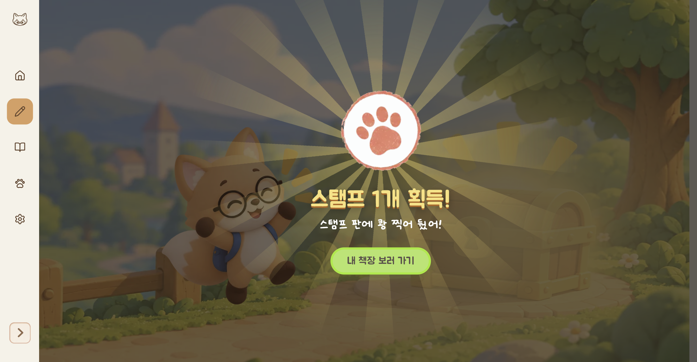
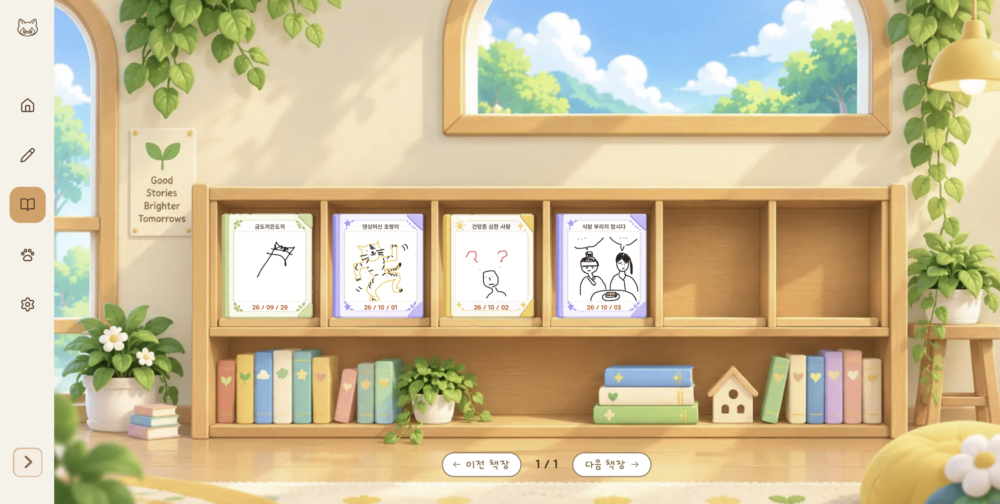
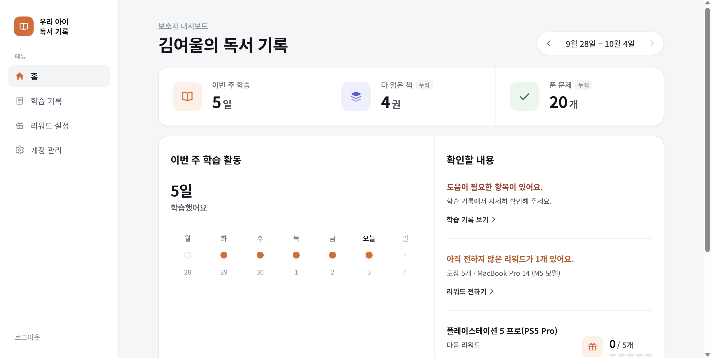
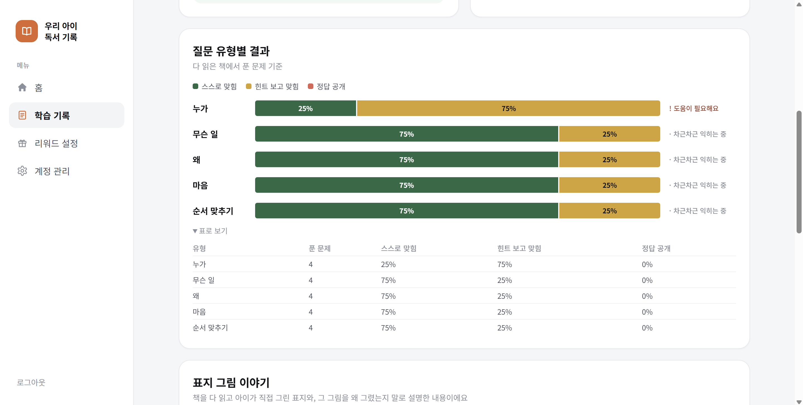

# [여울] 느린 학습자 독서 서비스 - 프로젝트 소개

> 2026-10-31 velog에 처음 발행 · [원문 보기](https://velog.io/@_2_min_9_/%EC%97%AC%EC%9A%B8-%EB%8A%90%EB%A6%B0-%ED%95%99%EC%8A%B5%EC%9E%90-%EB%8F%85%EC%84%9C-%EC%84%9C%EB%B9%84%EC%8A%A4-%ED%94%84%EB%A1%9C%EC%A0%9D%ED%8A%B8-%EC%86%8C%EA%B0%9C)

**여울**은 경계선 지능 초등 저학년 학생을 위한 독서 학습 서비스다.

2026년 8월부터 9월까지 진행된 **AI(클로드 코드) 기반 VIBE CODING 실전활용 경진대회**에 참여했던 일련의 과정과 경험들을 정리하여 포스팅 하려 한다.

- **팀명**: 교권보호소
- **팀원 구성**: 과 동기 3명
- **담당 파트**: Backend, Cloud/Infra
- **수상**: 대상

---

## 주제 선정 이유

**경계선 지적 기능(Borderline Intellectual Function; BIF) 또는 경계선 지능**은 표준화지능검사를 실시하여 IQ 71~84 사이에 속하는 것으로 분류되는 사람들을 가리킨다.

경계선 지능 학생들은 제도적 사각지대에 놓여있다.

학습과 사회 적응 등 일상생활 전반에서 어려움을 겪지만, 법적으로 장애인에 해당하지 않아 장애등급에 따른 복지 혜택이나 공적 지원을 받지 못하는 경우가 많다.

가장 많은 시간을 보내는 학교에서 적절한 교육을 받지 못하기 때문에 외부 기관에서 맞춤 교육을 받아야 하는데, 외부 기관 역시 전문 인력과 교재, 프로그램 부족 등의 문제를 함께 겪고 있다.

>["공백 속 700만명" 경계선지능인 지원체계 갖춰야](https://www.ohmynews.com/NWS_Web/View/at_pg.aspx?CNTN_CD=A0003203967) - 오마이뉴스, 26.02.02

경계선 지능 학생들은 언어 능력이 상대적으로 부족해, 대화의 맥락을 파악하거나 공감하는 데 어려움을 겪는 경우가 많다. 이는 또래 관계를 비롯한 사회생활 전반의 어려움으로 이어지기 쉽다.

우리 프로젝트는 느린 학습자가 스스로 책 한 권을 완성하는 경험을 통해 학습 간극을 줄이고 언어 능력을 키워나갈 수 있도록 돕는 것을 목표로 했다. 궁극적으로는 이를 통해 아이들이 사회적 관계와 활동에 더 자신 있게 참여할 수 있도록 돕고자 했다.

## 팀 운영 방식

대회 일정은 8월 초부터였지만, 실제 코딩은 9월부터 시작했다. 8월은 바이브 코딩 전반에 대한 교육 기간이었다.

**멘토링**은 매주 진행됐지만 코드 리뷰는 하지 않았다. 비즈니스 모델, 주제의 적합성처럼 코드 바깥의 것들을 현업 종사자분들이 짚어주셨다.

**팀 회의**도 매주 진행했는데, 꼭 다뤘던 한 가지는 프로젝트의 전체 흐름을 다시 맞추는 일이었다. 팀원 각자가 개인 클로드를 따로 돌리고 있었기 때문에, 방치하면 네 개의 클로드가 각자 다른 방향으로 뻗어나갈 수 있었다. 이 문제를 어떻게 풀었는지는 다음 글에서 자세히 다룬다.

## 1차 배포

학기를 병행하며 진행한 프로젝트는 결코 쉽지 않았다.

프론트엔드 담당이 Figma, Next.js 같은 툴·프레임워크는 물론 팀 프로젝트 자체가 처음이었던 탓에, 원래 백엔드를 함께 맡기로 했던 인원이 프론트엔드로 재배정됐다. 그러면서 백엔드와 인프라를 혼자 맡게 됐고, 처음 구상했던 클라우드 인프라 설계는 마감 안에 끝내지 못했다.

결국 원래 구상은 접고, 프론트엔드·백엔드·DB를 Docker Compose로 묶어 EC2 한 대에 1차 배포했다. 완성도보다 "마감 안에 확실히 뜨는 것"을 우선한 선택이었다.

대회가 끝난 뒤에는 혼자 전체 코드를 다시 리뷰하고, 인프라를 처음부터 설계해 재구축했다.

---

## 이 시리즈에서 다룰 것

이어지는 글에서는 크게 세 가지를 다룰 예정이다.

먼저 대회 기간에 팀 전체가 AI와 함께 코드를 짰던 방식, 그리고 그 과정에서 자리 잡은 하네스 엔지니어링 이야기를 다음 글에서 바로 이어간다.

그다음은 백엔드를 설계하며 내렸던 결정들이다. 세션을 어디에 둘지, 동시성 문제를 어떻게 풀었는지, 외부 API 비용을 어떻게 통제했는지 같은 것들을 하나씩 정리한다.

마지막은 대회가 끝난 뒤 혼자 다시 지은 클라우드 인프라에 대해 다룬다. 망분리, 비밀 관리, 백업·복구 실습, 그리고 새 인프라에 처음 배포하며 만난 버그들까지 정리한다.

---

## 마무리

다음 글에서는 하네스 엔지니어링 이야기부터 이어간다. 같은 노션, 같은 깃허브를 보고 있어도 각자의 클로드가 다른 방향으로 뻗어나갈 수 있다는 걸, 매주 어떻게 바로잡았는지를 다룬다.

> [GitHub (true-education-backend)](https://github.com/MiMiMinGyu/true-education-backend)
