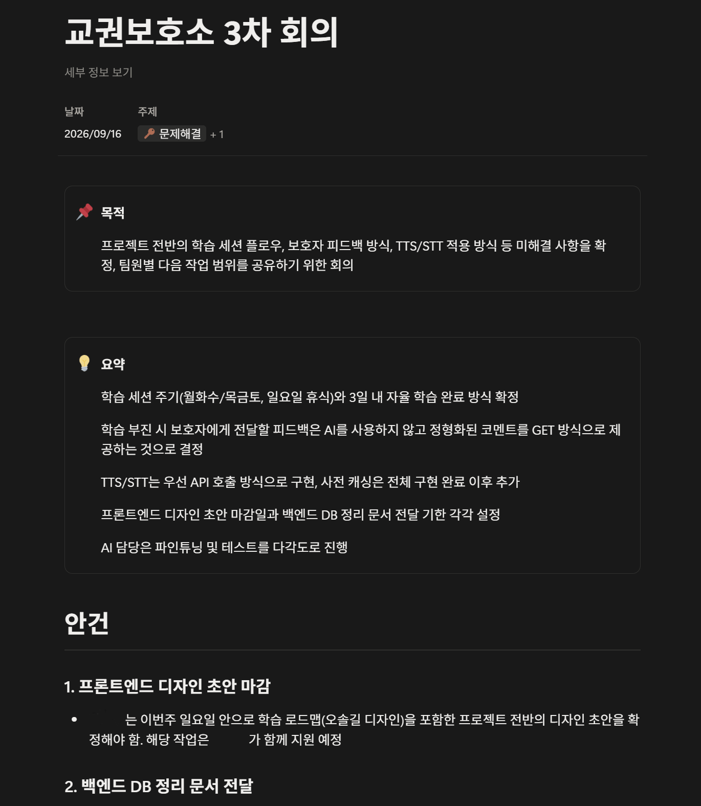

# [여울] 4명의 클로드가 같은 곳을 보게 만들기 - 하네스 엔지니어링

> velog 원문 · [원문 보기](https://velog.io/@_2_min_9_/%EC%97%AC%EC%9A%B8-4%EB%AA%85%EC%9D%98-%ED%81%B4%EB%A1%9C%EB%93%9C%EA%B0%80-%EA%B0%99%EC%9D%80-%EA%B3%B3%EC%9D%84-%EB%B3%B4%EA%B2%8C-%EB%A7%8C%EB%93%A4%EA%B8%B0-%ED%95%98%EB%84%A4%EC%8A%A4-%EC%97%94%EC%A7%80%EB%8B%88%EC%96%B4%EB%A7%81)

## 바이브코딩과 하네스 엔지니어링

바이브코딩은 AI에게 코드를 맡기고 결과를 받는 방식이다.
프롬프트를 쓰고, 나온 코드를 돌려보고, 안 되면 다시 쓴다.
혼자 작은 기능을 빠르게 만들 때는 이 정도로 충분하다.

문제는 여러 명이 같은 프로젝트를 각자의 AI로 동시에 작업할 때 생긴다.
각자의 AI는 그 순간 받은 프롬프트와 눈에 보이는 코드만 보고 판단한다.
프로젝트 전체가 어디로 가고 있는지, 다른 팀원이 무엇을 바꾸고 있는지는 모른다.
그대로 두면 네 명의 AI가 네 방향으로 프로젝트를 끌고 간다.

하네스 엔지니어링은 이것을 막기 위해 AI 작업에 틀을 씌우는 것이다.
지금 무엇을 해도 되고 무엇을 하면 안 되는지, 프로젝트가 지금 어디까지 왔는지를 AI가 매번 다시 알 수 있게 만드는 작업 전체를 말한다.

이 글에서는 대회 기간과 이후 혼자 인프라를 다시 만들던 기간, 두 시기에 실제로 썼던 방법들을 정리한다.

---

## 대회 기간 — 노션 회의록과 마크다운 명세

대회 기간에는 팀원 네 명이 각자의 컴퓨터에서 각자의 클로드를 돌렸다.
매주 한 번 회의를 진행한 후 노션에 회의록을 남기고, 그 주에 확정된 것과 아직 정해지지 않은 것을 정리했다.
다음 작업을 시작하기 전에는 이 회의록을 각자의 클로드에게 먼저 읽히는 것을 규칙으로 두었다.



사실 회의록만으로는 부족했다. 회의록은 그 주에 결정된 것을 기록하는 문서이고, 클로드가 코드를 만들 때 참조할 정확한 규격은 따로 필요했다.
그래서 API를 하나 설계할 때마다 엔드포인트와 요청·응답 형식을 마크다운으로 먼저 적어두었다.

`backend-logic-v5.md` 예시

```markdown
### 제출
`POST /assignments/{id}/questions/{questionId}/attempts`
`{ "answer": 1, "responseTimeMs": 4200 }`

응답
- 정답: `{ "correct": true, "finished": true }`
- 1차 오답: `{ "correct": false, "finished": false, "hint": "…" }`
- 2차 오답: `{ "correct": false, "finished": true, "answer": 1 }`
```
같은 원칙은 아직 정해지지 않은 부분에도 적용했다.
결정이 나지 않은 부분은 `CLAUDE.md`에 미정이라고 못박아두고, 클로드가 그 부분만큼은 임의로 채우지 않고 `// TODO:` 주석만 남기게 했다.
정해진 것과 정해지지 않은 것의 경계를 분명히 하는 것이 핵심이었다.

이처럼 팀원 모두가 같은 문서를 보고 시작하면, 누구의 클로드가 이 API를 구현하든 같은 모양의 응답이 나온다.
반대로 문서 없이 말로만 설명하면, 정답·오답을 나누는 응답 구조부터 서로 다르게 짤 수 있다.

---

## 재구축 기간 — AI가 넘지 못하게 만든 선

대회가 끝나고 포트폴리오용으로 인프라를 혼자 다시 만들 때는 상황이 달랐다.
팀원과의 동기화가 아니라, AI가 작업 범위를 넘어서지 않게 막는 것이 문제였다.

AWS 리소스를 만들 IAM 사용자를 새로 만들면서, 이 사용자가 자기 권한을 스스로 넓히지 못하게 명시적으로 막아두었다.

`terraform-user-policy.json` 예시

```json
{
  "Sid": "DenySelfEscalationAndOtherAccounts",
  "Effect": "Deny",
  "Action": [
    "iam:CreateUser",
    "iam:CreateAccessKey",
    "iam:AttachUserPolicy",
    "iam:PutUserPolicy"
  ],
  "Resource": "*"
}
```

이 정책이 있으면 AI가 작업 중 권한이 부족하다고 판단해도, 새 사용자를 만들거나 자기 자신에게 권한을 추가할 수 없다.
권한 부족은 작업을 막지만 권한 확장은 더 큰 위험이라, 이쪽을 먼저 닫아두었다.

비슷한 일이 실제로 한 번 있었다. RDS와 암호화 연결을 붙이는 과정에서 인증서 검증 오류가 반복됐다.

> **문제 상황:** RDS가 TLS 연결을 강제하는데, Node가 기본으로 가진 인증서 목록에는 RDS 인증서를 발급한 기관이 없어 연결이 거부됐다.
>
> **막힌 선택지:** 인증서 검증을 꺼버리면(`sslmode=no-verify`) 당장은 연결된다. 하지만 이것은 Claude Code가 "TLS 검증 약화"로 분류해 실행 자체를 막았다.
>
> **해결:** RDS 공개 인증서 번들을 이미지에 넣고, `NODE_EXTRA_CA_CERTS`로 Node에게 그 인증서를 신뢰하라고 알렸다. 검증은 그대로 켜둔 채 연결만 정상화했다.

막혔던 순간에는 번거롭다고 느꼈지만, 돌이켜보면 하네스가 제대로 작동한 사례였다.
편법과 정석이 다를 때, 안전장치가 편법을 못 쓰게 막아준 셈이다.

---

## 마무리

두 사례는 결국 같은 것을 가리킨다.

정해진 것은 문서로 고정하여 AI가 다시 해석할 여지를 없애고, 안 되는 것은 권한 자체를 막아 AI가 시도조차 못 하게 만드는 것.
사람이 할 일은 코드를 직접 짜는 것에서, 이 경계를 미리 그어두는 쪽으로 옮겨갔다.

다음 글에서는 이 경계 안에서 실제로 어떤 기술적 선택을 했는지 다룬다.
