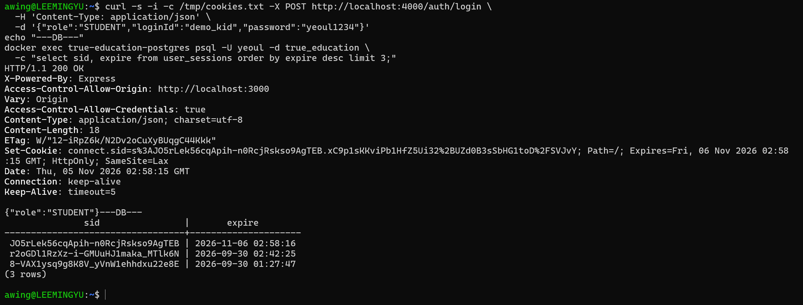
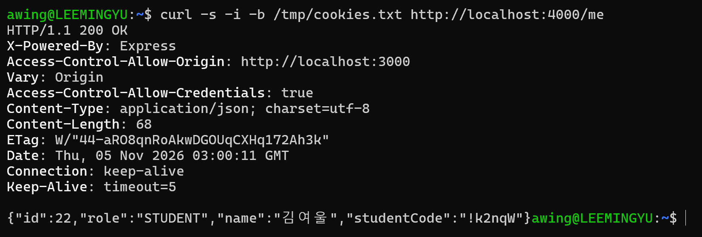
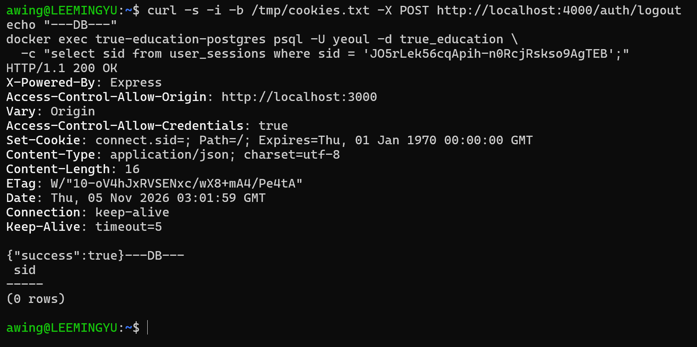

# [여울] Redis의 자리는 남겨두다 - 세션 저장소

> velog 원문 · [원문 보기](https://velog.io/@_2_min_9_/%EC%97%AC%EC%9A%B8-Redis%EC%9D%98-%EC%9E%90%EB%A6%AC%EB%8A%94-%EB%82%A8%EA%B2%A8%EB%91%90%EB%8B%A4-%EC%84%B8%EC%85%98-%EC%A0%80%EC%9E%A5%EC%86%8C)

## 문제 — 세션이 사라지는 상황

세션+쿠키 로그인을 처음 구현할 때는 `express-session`의 기본 저장소인 `MemoryStore`를 그대로 썼다.
서버 프로세스의 메모리에 세션을 들고 있는 방식이라, 개발 중에는 아무 문제가 없었다.

문제는 `MemoryStore`가 서버 프로세스 하나에만 묶여 있다는 점이다.
서버를 여러 대로 띄우면 로그인한 서버와 다음 요청이 간 서버가 다를 수 있고, 그러면 로그인한 적 없는 사람처럼 처리된다.
서버를 한 대만 재시작해도 메모리에 있던 세션이 전부 날아가, 로그인해 있던 사용자가 전부 로그아웃된다.

베타 서비스라 당장 여러 대를 띄울 계획은 없었지만, 재시작은 다른 문제였다.
배포할 때마다, 설정을 바꿔 서버를 재시작할 때마다 모든 사용자가 다시 로그인해야 한다는 뜻이었다.
세션을 **서버 프로세스 밖**, 어딘가 **영속적인 곳**에 두어야 했다.

---

## 흔한 정답, 그리고 다른 선택

세션을 서버 프로세스 밖에 두는 문제라면, 보통 가장 먼저 나오는 답은 **Redis**다.
세션 저장소의 사실상 표준이고, 레퍼런스도 어디서나 쉽게 찾을 수 있다.

하지만 이번엔 Redis를 새로 넣지 않았다.
이미 PostgreSQL을 쓰고 있었고, 베타 규모(대회 시연용)에서는 세션 조회 부하가 그리 크지 않았다.
거기에 인프라 구성요소를 하나 늘리면 그만큼 운영·장애 지점도 늘어난다.
당장 필요하지도 않은 것을 미리 들여놓을 이유가 없었다.

그래서 `connect-pg-simple`로 세션을 PostgreSQL의 `user_sessions` 테이블에 그대로 저장했다.

`db-schema.sql` 예시

```sql
CREATE TABLE user_sessions (
    sid     VARCHAR      NOT NULL PRIMARY KEY,
    sess    JSON         NOT NULL,
    expire  TIMESTAMP(6) NOT NULL
);
```

세션 하나를 위해 Redis 서버를 따로 띄우는 대신, 원래 있던 데이터베이스에 테이블 하나를 추가하는 쪽을 택했다.

---

## Redis의 자리는 남겨두다

PostgreSQL을 선택했다고 해서 Redis로 가는 길을 막은 것은 아니다.
`express-session`은 세션을 어디에 저장할지를 `store`라는 옵션 하나로 분리해둔다.
지금은 그 자리에 `connect-pg-simple`이 들어가 있을 뿐이다.

`app.setup.ts` 예시

```typescript
const store = new PgSessionStore({
  conString: process.env.DATABASE_URL,
  tableName: 'user_sessions',
  createTableIfMissing: false,
});

app.use(
  session({
    secret: process.env.SESSION_SECRET,
    resave: false,
    saveUninitialized: false,
    cookie: { httpOnly: true, secure: true, sameSite: 'lax' },
    store,
  }),
);
```

세션을 읽고 쓰는 나머지 코드는 `store`가 PostgreSQL인지 Redis인지 모른다.
트래픽이 늘어 세션 조회가 병목이 되면, `store`를 Redis 구현체로 바꾸는 것만으로 끝난다.

지금은 쓰지 않지만, 쓸 일이 생겨도 코드를 갈아엎을 필요는 없게 만든 선택이었다.

---

## 검증

실제로 재시작해도 세션이 살아있는지 직접 확인했다.

로그인하면 서버가 내려주는 `connect.sid` 쿠키와 같은 시점에, `user_sessions` 테이블에는 그 쿠키에 해당하는 행이 생긴다.



여기서 서버 프로세스를 종료하고 다시 띄운 뒤, 같은 쿠키로 `/me`를 다시 호출했다.
재시작 전과 완전히 같은 응답이 왔다. 세션이 서버 메모리가 아니라 DB에 있다는 뜻이다.



로그아웃하면 이 행도 그대로 사라진다.



---

## 마무리

세션 저장소 하나를 고르는 데 총 세 단계를 거쳤다.
지금 규모에 꼭 필요한지 따지고, 나중에 필요해지면 바꿀 수 있는 자리를 남겨두고, 마지막으로 그 전제가 실제로 맞는지 재시작까지 해보며 확인했다.

구성요소를 늘리지 않는 결정도, 확장 경로를 미리 뚫어두는 설계도, 결국 지금 정말 필요한지를 따져본 결과였다.

다음 글에서는 같은 DB 안에서 찾은 동시성 버그를 다룰 예정이다.
학생·보호자 테이블을 나눠놨을 뿐인데, 같은 아이디로 동시에 가입하면 둘 다 성공해버리는 상황이 있었다.
