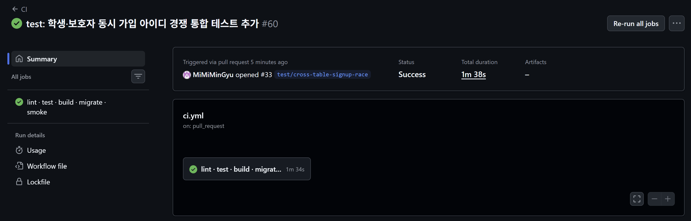
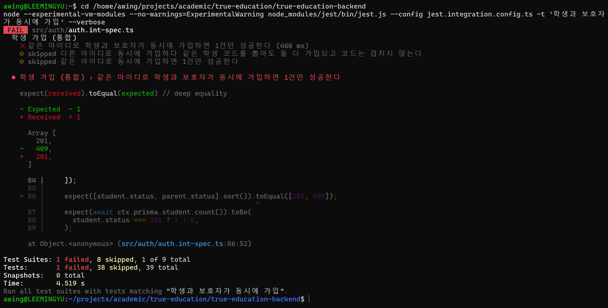

# [여울] UNIQUE 제약이 못 막아준 순간 - 아이디 유일성

> velog 원문 · [원문 보기](https://velog.io/@_2_min_9_/%EC%97%AC%EC%9A%B8-UNIQUE-%EC%A0%9C%EC%95%BD%EC%9D%B4-%EB%AA%BB-%EB%A7%89%EC%95%84%EC%A4%80-%EC%88%9C%EA%B0%84-%EC%95%84%EC%9D%B4%EB%94%94-%EC%9C%A0%EC%9D%BC%EC%84%B1)

## 문제

이 프로젝트의 사용자는 학생과 보호자, 두 유형으로 나뉜다.
둘에게 적용되는 서비스가 다르기 때문에 학생과 보호자는 테이블도 따로 두었다.
각 역할이 가진 필드 자체가 달라서(학생은 생년·학생 코드, 보호자는 약관 동의 등), 한 테이블에 구분 컬럼 하나로 합치면 서로의 필드가 계속 NULL로 남는 **희소 테이블**이 될 우려가 있었기 때문이다.


로그인 화면에서 탭으로 역할을 고르면, 그 역할에 해당하는 테이블만 조회하는 구조다.
그런데 아이디 자체는 학생이든 보호자든 전체를 통틀어 하나만 쓸 수 있어야 했다.

문제는 이 제약을 DB에 그대로 걸 수 없다는 점이다.
`UNIQUE` 제약은 한 테이블 안에서만 작동한다.
`students.login_id`에 걸거나 `parents.login_id`에 걸 수는 있어도, "두 테이블을 합쳐서 하나만"이라는 제약은 PostgreSQL이 기본으로 제공하지 않는다.

DB에서 자체적으로 보장해주지 않는 제약이었기 때문에, 애플리케이션 레벨에서 직접 막아야 했다.
가입 요청이 오면 먼저 두 테이블 모두에서 같은 아이디가 있는지 확인하고, 없으면 그제서야 삽입한다(`check-then-insert`).

하지만 이 조치가 완전히 무결하지는 않았다.
"확인"과 "삽입" 사이에는 틈이 있다.
같은 아이디로 학생 가입 요청과 보호자 가입 요청이 거의 동시에 들어오면, 둘 다 "확인" 단계에서는 중복을 찾지 못한다.
둘 다 삽입에 성공해, 같은 아이디로 학생 계정과 보호자 계정이 동시에 생겨버린다.

---

## 해결

문제는 명확했다. 같은 아이디로 들어온 요청끼리는 순서를 강제해야 하고, 다른 아이디는 그대로 병렬로 처리돼야 한다.
Redis 같은 외부 락을 새로 들이는 방법도 있었지만, 3번 글에서 이미 한 번 피했던 선택이다.
여기서도 같은 기준을 적용해, PostgreSQL이 이미 가진 기능으로 해결할 수 있는지부터 확인했다.

PostgreSQL에는 `pg_advisory_xact_lock(hashtext(loginId))`라는 함수가 있었다.
같은 아이디(의 해시값)로 들어온 요청만 잠금을 걸고, 트랜잭션이 끝나면 자동으로 풀린다.
다른 아이디로 들어온 요청은 이 잠금과 무관하게 그대로 진행된다.

`prisma-user.repository.ts` 예시

```typescript
await prisma.$transaction(async (tx) => {
  await tx.$executeRaw`SELECT pg_advisory_xact_lock(hashtext(${loginId}))`;

  const existsAsStudent = await tx.student.findUnique({ where: { loginId } });
  const existsAsParent = await tx.parent.findUnique({ where: { loginId } });
  if (existsAsStudent || existsAsParent) {
    throw new ConflictException('이미 사용 중인 아이디입니다');
  }

  // 여기서 삽입
});
```

잠금을 건 다음에야 두 테이블을 다시 확인하고 삽입한다.
같은 아이디로 동시에 요청이 들어와도, 잠금을 먼저 잡은 쪽이 확인·삽입을 끝낼 때까지 다른 쪽은 기다린다.
기다린 쪽이 확인할 땐 이미 상대방의 삽입이 끝난 뒤이기 때문에, 중복을 놓치지 않는다.

잠금이 걸리는 범위는 좁다.
같은 아이디로 동시에 들어온 요청끼리만 순서를 기다린다.
그마저도 아이디 중복 확인과 삽입이 끝나는 짧은 트랜잭션 동안뿐이기 때문에, 지연으로 인한 사용자 경험 저해는 크지 않다고 봤다.

---

## 검증

같은 아이디로 학생 가입과 보호자 가입을 동시에 보내면 둘 중 하나만 성공해야 한다.
이 글을 처음 쓸 당시엔 이 상황을 5번 반복해서 라이브로 확인했다.
매번 정확히 1건만 성공했고, 승자가 학생·보호자 양쪽에서 번갈아 나왔다.
한쪽이 항상 이기는 게 아니라 실제로 경쟁이 일어났다는 뜻이었다.

다만 이 검증은 스크립트로 즉석에서 한 것이라 깃허브에 남아있지 않았다.
그래서 이번에 같은 상황을 정식 통합 테스트로 작성하여 커밋했다(Race Test).



[CI 실행 기록](https://github.com/MiMiMinGyu/true-education-backend/actions/runs/41960334161)과 [테스트 코드](https://github.com/MiMiMinGyu/true-education-backend/blob/287908ea481323c8679af85e3367b63d2377205e/src/auth/auth.int-spec.ts)는 직접 확인할 수 있다.

여기서도 테스트가 진짜 버그를 잡는지 확인했다(Mutation Test). `lockLoginId` 안의 잠금 코드 한 줄을 잠깐 주석 처리하고 같은 테스트를 다시 돌렸다.

해당 코드는 의도적으로 깨뜨린 것이라 커밋하지 않았고, 그 순간을 직접 캡처해뒀다.



잠금을 지우자 학생·보호자 둘 다 성공했다.
테스트가 이 차이를 실제로 잡아낸다는 것을 확인한 뒤, 코드를 원래대로 되돌렸다.

---

## 마무리

테이블을 나눈 이유는 명확했지만, 그 대가로 생긴 구멍은 눈에 잘 띄지 않았다.
DB가 보장해주지 않는 제약은 코드가 떠안아야 했고, 코드로 막아도 확인과 삽입 사이의 틈은 남아 있었다.

이 틈을 메운 것은 새로운 인프라가 아니라 PostgreSQL이 이미 가진 함수 하나였다.
그 해법이 진짜 맞는지는 테스트를 통과시키는 것만으로는 부족했다.
잠금을 일부러 빼고, 버그가 다시 나타나는 것을 직접 확인해야 했다.

다음 글에서는 비용 얘기를 다룰 예정이다.
외부 유료 API(TTS) 하나를 캐싱 설계 하나로 학생 수와 무관하게 만든 이야기다.
