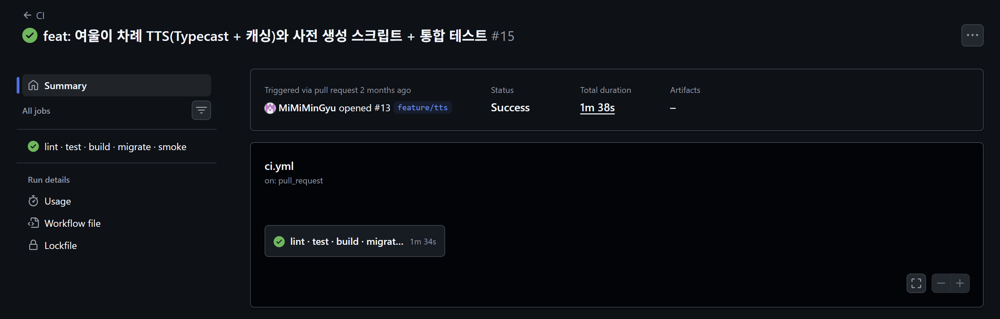
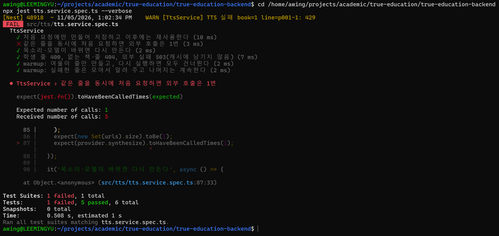

# [여울] 사용자 수와 비용의 분리 - TTS 캐싱

> velog 원문 · [원문 보기](https://velog.io/@_2_min_9_/%EC%97%AC%EC%9A%B8-%EC%82%AC%EC%9A%A9%EC%9E%90-%EC%88%98%EC%99%80-%EB%B9%84%EC%9A%A9%EC%9D%98-%EB%B6%84%EB%A6%AC-TTS-%EC%BA%90%EC%8B%B1)

## 배경 — 왜 목소리가 필요했나

경계선 지능 학생들은 주의집중 시간이 비교적 짧다. 서울교육대학교 강옥려 교수님이 정리하신 연구에서는 이 특성을 이렇게 설명한다.

> 언어로만 설명하는 수업에 30분 이상 집중할 수 없다. 따라서 이들의 주의집중 능력과 시간을 높이기 위해서는 교육매체를 사용한다거나 구체적인 학습자료를 사용하고, 구체적인 상황을 통해서 정보를 제시하는 것이 필요하다.
— 강옥려(2016), 「경계선급 지능 아동의 교육: 과제와 해결 방안」

동화를 텍스트로만 보여주는 대신, 여울이라는 캐릭터가 목소리로 함께 읽어주는 방식을 택한 이유가 여기 있다.
음성이 있으면 아이가 혼자 글자를 좇는 것보다 집중을 붙잡아 두기가 쉬울 것이라고 판단했다. 이 판단은 논문에서 직접 검증된 내용이 아니라, 위 특성에서 우리 팀이 끌어낸 추론이다.

번갈아 읽기에서 여울이가 먼저 읽고 학생이 다음 줄을 읽는 구조도 같은 맥락에서 설계했다.
서울특별시교육청의 「경계선 지능 학생 지원 가이드북」(2020)도 학령기 학생을 지도할 때 이렇게 권한다.

> 개념과 절차를 설명하기 위해 교사가 시범을 보이고 학생이 따라 하도록 해주세요. 보고 듣고 말하는 통합적인 학습 방식으로 이루어지도록 수업을 계획해 주세요.
— 서울특별시교육청(2020), 「경계선 지능 학생 지원 가이드북」

---

## 문제 — 비용이 사용자 수를 따라간다

Typecast는 1글자당 1크레딧을 쓴다. 무료 요금제는 월 15,000크레딧까지다.

문제는 호출 시점이다.
학생이 동화를 펼칠 때마다 그 줄의 음성을 매번 API로 호출하면, 같은 문장을 100명이 읽을 때 100번 돈을 내고 만드는 셈이 된다.
비용이 콘텐츠 양이 아니라 학생 수와 재생 횟수에 비례해서 불어난다.

무료 크레딧으로 감당할 수 있는 것은 많아야 책 몇 권 분량이다.
학생이 늘어날수록 이 한도는 점점 더 빨리 바닥난다.

---

## 해결 — 캐싱으로 비용을 콘텐츠 크기에 묶다

줄 하나를 처음 요청할 때만 Typecast를 호출하고, 그 결과를 저장해서 재사용하면 된다.
캐시 키는 `sha256(글 + 목소리·모델·출력 옵션)`이다.
목소리나 모델을 바꾸면 해시가 달라져서 자동으로 다시 생성된다.

`tts.service.ts` 예시

```typescript
private async ensureAudio(bookId: number, lineId: string, text: string): Promise<string> {
  const hash = this.hashOf(text);
  const cached = await this.repository.findAudio(bookId, lineId);
  if (cached?.contentHash === hash) return cached.key;

  const jobKey = `${bookId}:${lineId}:${hash}`;
  let job = this.inFlight.get(jobKey);
  if (!job) {
    job = this.generate(bookId, lineId, text, hash).finally(() =>
      this.inFlight.delete(jobKey),
    );
    this.inFlight.set(jobKey, job);
  }
  return job;
}
```

캐시에 있으면 바로 저장된 키를 돌려준다. 없으면 생성 작업을 시작하는데, 이 작업을 `inFlight`라는 맵에 등록해둔다.
같은 줄을 여러 학생이 동시에 처음 요청해도, 이미 진행 중인 작업을 그대로 공유하기 때문에 Typecast 호출은 한 번만 나간다.

동시에 들어온 요청이 같은 일을 중복으로 하지 않게 막는다는 점에서, [4번 글](04-id-uniqueness.md)과 같은 원리다.

---

## 검증

Typecast를 실제로 호출하면서 검증할 필요는 없었다.
확인하려는 것은 "캐싱 로직이 맞는가"이지 Typecast 자체가 아니기 때문에, 단위 테스트에서 Typecast를 가짜로 대체하여 검증을 진행했다(Race Test).



[CI 실행 기록](https://github.com/MiMiMinGyu/true-education-backend/actions/runs/36238092231)과 [테스트 코드](https://github.com/MiMiMinGyu/true-education-backend/blob/8e8ebd162527b3b92d3b39d67363f4197f050297/src/tts/tts.service.spec.ts)는 직접 확인할 수 있다.

여기서도 테스트가 이 상황을 진짜로 잡아내는지 확인했다(Mutation Test).
`inFlight` 공유 로직을 잠깐 지우고 같은 테스트를 다시 돌렸다.

해당 코드는 의도적으로 깨뜨린 것이라 커밋하지 않았고, 그 순간을 직접 캡처해뒀다.



공유 로직이 없으면 외부 API를 다섯 번 호출하게 된다.
테스트가 이 차이를 실제로 잡아낸다는 것을 확인한 뒤, 코드를 원래대로 되돌렸다.

---

## 수동에서 자동으로

처음엔 발표 전에 `tts:warmup` 스크립트를 직접 돌리는 식이었다.
시연할 동화를 미리 정해두고, 사람이 명령어를 실행해서 음성을 전부 만들어뒀다.

문제는 운영 중에 새 동화가 들어올 때였다.
아무도 `tts:warmup`을 돌리지 않으면, 그 책을 처음 펼치는 학생이 줄마다 캐시 없는 상태로 Typecast 응답을 기다려야 했다.

그래서 이 과정이 자동으로 수행되게끔 바꿨다.
책이 저장되거나 바뀌는 순간 그 책만 즉시 큐에 넣고(이벤트), 서버 시작 30초 뒤와 이후 30분마다 모든 책을 한 번씩 점검하여 캐시가 빠진 줄만 채운다(안전망).

`tts-auto-warmup.service.ts` 예시

```typescript
scheduleBook(externalId: string): void {
  if (!this.active) return;
  if (!this.queue.includes(externalId)) this.queue.push(externalId);
  this.drain();
}

async sweep(): Promise<void> {
  if (!this.active) return;
  const books = await this.repository.listBooks();
  books.forEach(({ externalId }) => {
    if (!this.queue.includes(externalId)) this.queue.push(externalId);
  });
  await this.drain();
}
```

이벤트는 놓친 것 없이 빠르게 처리하고, 점검은 이벤트가 놓친 것을 30분 안에 확실히 잡아준다.
캐시 키가 내용 해시라서 점검이 멱등하다.
이미 있는 줄은 건너뛰므로, 몇 번을 다시 돌려도 과금이 없다.

Typecast 무료 요금제의 동시 요청 제한도 그대로 지킨다.
한 번에 책 한 권씩만 처리하고, 책 안에서는 동시 2건으로 묶는다.

실제로 배포 직후 로그는 다음과 같았다.

```bash
[folkency-5747] 음성 생성 3 · 이미 있음 0 · 실패 0
```

사람이 손대지 않아도 새 책의 음성이 자동으로 만들어진 것이다.

---

## 마무리

시작은 단순했다. '일단 목소리가 나오게 만들자'는 것이 전부였다.
하지만 팀원들과 회의를 거듭하며 TTS의 전체 흐름을 들여다보니, 진짜 중요한 것은 '목소리를 얼마나 싸게, 얼마나 안정적으로 만들어서 서빙하는가'였다.

캐싱 하나로 비용은 학생 수와 무관해졌고, 동시 요청을 합치는 로직으로 중복 호출을 막았고, 자동화로 사람이 챙기지 않아도 새 콘텐츠가 바로 준비되게 만들었다.
위 세 결과의 구조는 각기 다르지만 방향은 같다.
매번 사람이나 외부 API에 기대는 대신, 한 번 해둔 일을 계속 재사용하는 것이다.

다음 글에서는 전혀 다른 종류의 문제를 다룰 예정이다.
학생 코드 하나만 알면 누구든 그 아이와 연결될 수 있었던 보안 구멍을 찾아낸 이야기다.
