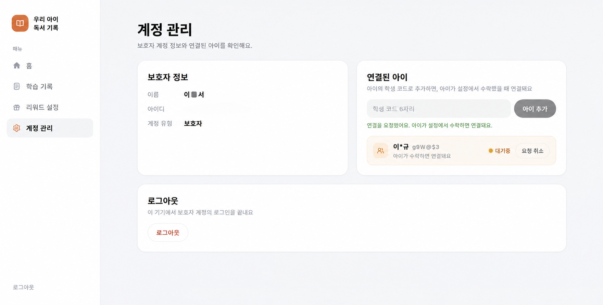
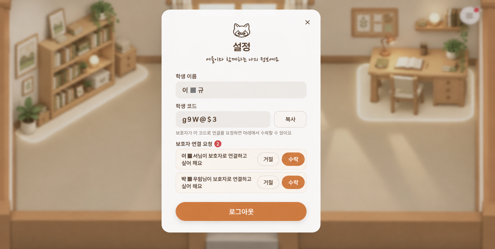
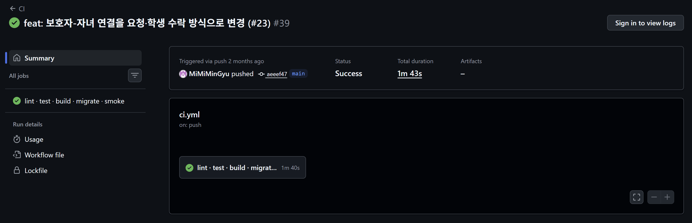
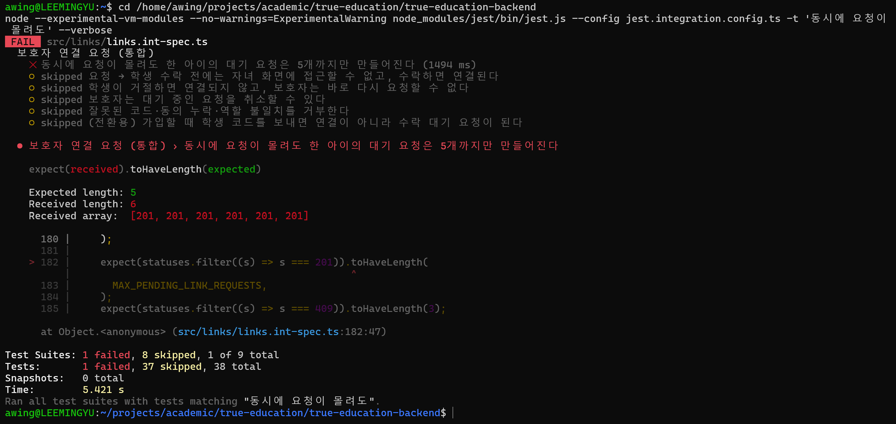

# [여울] 개인정보와 관련 있다면 더욱 민감하게 - 연결 요청·수락

> velog 원문 · [원문 보기](https://velog.io/@_2_min_9_/%EC%97%AC%EC%9A%B8-%EA%B0%9C%EC%9D%B8%EC%A0%95%EB%B3%B4%EC%99%80-%EA%B4%80%EB%A0%A8-%EC%9E%88%EB%8B%A4%EB%A9%B4-%EB%8D%94%EC%9A%B1-%EB%AF%BC%EA%B0%90%ED%95%98%EA%B2%8C-%EC%97%B0%EA%B2%B0-%EC%9A%94%EC%B2%AD%EC%88%98%EB%9D%BD)

처음엔 보호자가 회원가입 화면에서 학생 코드 6자리만 입력하면 그 자리에서 가입과 동시에 학생 계정과 연결됐다.

문제는 코드가 약해서가 아니었다.
영문·숫자·특수문자를 섞은 이 문자열의 경우의 수는 약 515억 개로, 무작위로 맞히기는 쉽지 않았다.

진짜 문제는 구조였다.
코드를 알고 있다는 사실 하나만으로, 아이의 학습 기록에 접근할 수 있는 권한이 그대로 넘어갔다.

코드는 생각보다 쉽게 새어 나갈 수 있다.
타인이 설정 화면을 우연히 보는 정도로도 충분했다.
그 순간 그 사람은 아이의 동의 없이 학습 기록을 들여다볼 수 있는 보호자가 됐다.

---

## 해결

단순히 코드를 아는 것과 연결을 허락하는 것을 분리했다.
보호자가 코드로 하는 것은 더 이상 "연결"이 아니라 "요청"이다.
그 아이가 수락해야만 실제로 연결된다.



학생이 홈 화면을 불러오거나 다른 창에 갔다가 돌아올 때마다, 그사이 들어온 요청이 있는지 확인해서 메뉴에 표시한다.
수락 전까지 보호자 화면에는 아이 이름이 가려져서 보인다.
가령, "김여울"이면 "김*울"로 보인다.



`links.service.ts` 예시

```typescript
export function maskName(name: string): string {
  const chars = [...name];
  if (chars.length <= 1) return name;
  if (chars.length === 2) return `${chars[0]}*`;
  return `${chars[0]}${'*'.repeat(chars.length - 2)}${chars[chars.length - 1]}`;
}
```

요청 자체도 무제한으로 쌓이게 두지 않았다.
같은 아이에게 대기 중인 요청은 최대 5개, 거절당하면 24시간 동안 그 보호자는 같은 아이에게 다시 요청할 수 없다.

이 제한도 동시 요청에서 깨지면 안 된다.
같은 학생에게 여러 보호자가 동시에 요청을 보내면, 대기 요청 수를 세는 시점과 새로 끼워 넣는 시점 사이에 틈이 생길 수 있다.
그래서 요청을 처리하기 전에 그 학생 행을 잠근다.

`prisma-link.repository.ts` 예시

```typescript
export async function lockStudentLinks(
  tx: Prisma.TransactionClient,
  studentId: number,
) {
  await tx.$executeRaw`SELECT id FROM students WHERE id = ${studentId} FOR UPDATE`;
}
```

같은 학생에게 들어온 요청끼리만 순서를 기다리고, 다른 학생에게 온 요청은 영향받지 않는다.
잠그는 단위가 좁다는 점에서 [4번 글](04-id-uniqueness.md)의 `advisory lock`과 같은 방향이다.

알림도 실시간 서버(WebSocket) 대신, 학생이 홈 화면을 불러오거나 창에 돌아올 때 조회하는 방식으로 충분하다고 판단했다.
몇 초 안에 전달돼야 하는 알림이 아니라서, 연결 유지용 인프라를 따로 두지 않았다.

---

## 검증

이 글의 핵심은 "요청만으로는 접근이 안 되고, 수락해야만 접근된다"는 것이다. 이것부터 직접 확인했다.

보호자가 요청을 보낸 직후 그 학생의 대시보드를 조회하면 403이 떨어진다. 학생이 수락한 뒤에야 같은 조회가 200으로 바뀐다.

`links.int-spec.ts` 예시

```typescript
await parent.agent
  .get(`/parents/me/students/${kid.studentId}/dashboard`)
  .expect(403); // 수락 전

await kid.agent
  .post(`/students/me/link-requests/${parent.parentId}/accept`)
  .expect(200, { parentId: parent.parentId, status: 'ACCEPTED' });

await parent.agent
  .get(`/parents/me/students/${kid.studentId}/dashboard`)
  .expect(200); // 수락 후
```



[CI 실행 기록](https://github.com/MiMiMinGyu/true-education-backend/actions/runs/36461763155)과 [테스트 코드](https://github.com/MiMiMinGyu/true-education-backend/blob/aeeef47806baade90ec5603eb40c5719bf38253c/src/links/links.int-spec.ts)는 직접 확인할 수 있다.

이 외에, 요청 수를 제한하는 부수적인 장치도 **동시성 문제가** 있어서 같이 확인했다.
같은 아이에게 대기 요청이 5개까지만 쌓이게 막아둔 부분인데, 여러 보호자가 동시에 요청을 보내면 이 제한 자체가 깨질 수 있었다(Race Test).

같은 학생에게 보호자 8명이 동시에 연결을 요청했다.
8건 중 정확히 5건만 201, 나머지 3건은 409였다.
이것도 같은 CI 실행(위 캡처)에 포함된 테스트다.

여기서도 테스트가 이 상황을 진짜로 잡아내는지 확인했다(Mutation Test).
행 잠금을 잠깐 지우고 같은 테스트를 다시 돌렸다.

해당 코드는 의도적으로 깨뜨린 것이라 커밋하지 않았고, 그 순간을 직접 캡처해뒀다.



잠금을 지우자 8명 중 6명이 통과했다.
레이스 컨디션 특성상 정확한 숫자는 실행마다 달라지지만, 5개 제한이 깨진다는 사실은 매번 같았다.
테스트가 이 차이를 실제로 잡아낸다는 것을 확인한 뒤, 코드를 원래대로 되돌렸다.

---

## 마무리

학생 코드를 더 길게 만들거나 화면에서 가리는 것만으로는 이 문제를 풀 수 없었다.
진짜 바꿔야 했던 것은 "알기만 하면 들어갈 수 있다"는 구조 자체였다.

요청·수락이라는 한 단계를 끼워 넣은 것만으로, 접근권은 코드를 쥔 사람이 아니라 당사자의 동의에서 나오게 됐다.
그 과정에서 생긴 부수적인 문제(요청 남발)도 가진 도구(DB 행 잠금)로 풀 수 있었고, 테스트로 직접 확인했다.

다음 글부터는 코드가 아니라 인프라를 다룬다.
대회를 마친 뒤 혼자 **Terraform**으로 처음부터 다시 지은 클라우드 구조 이야기다.
