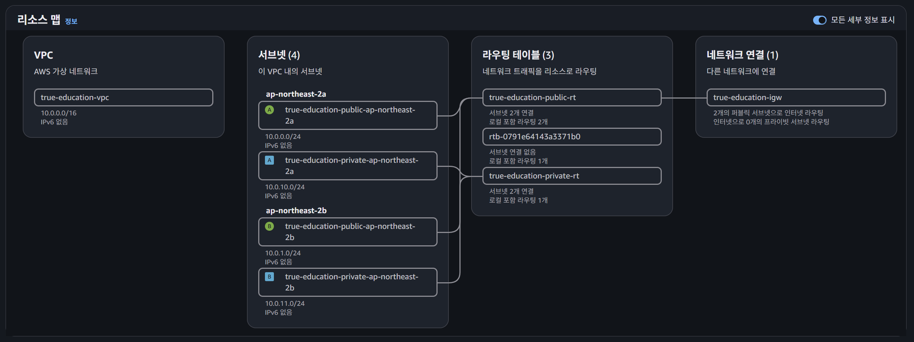
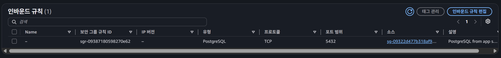
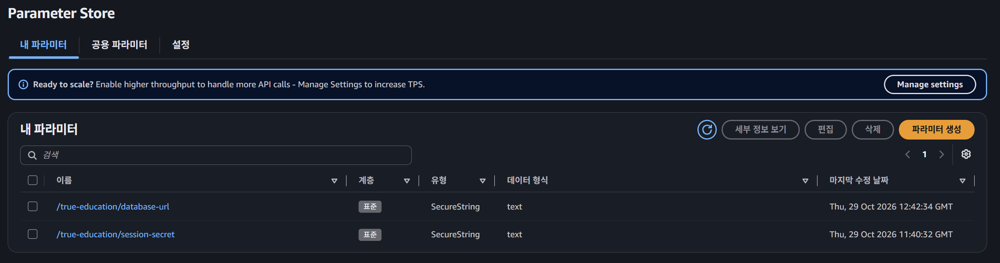
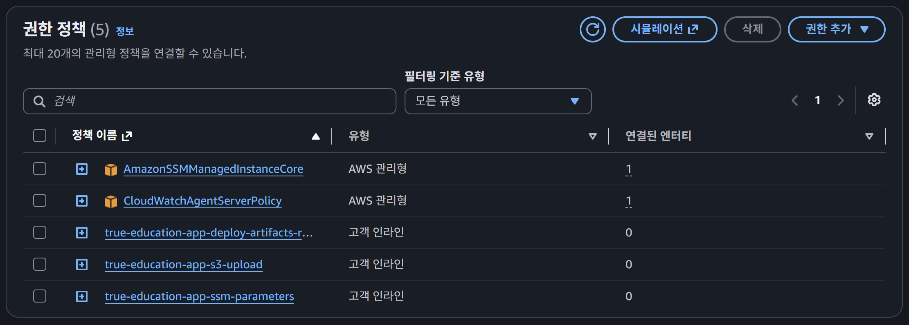
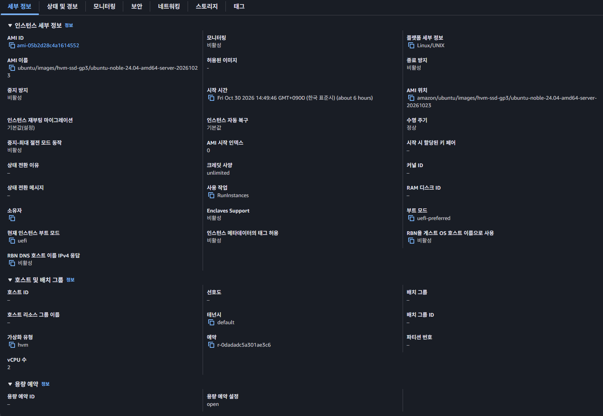
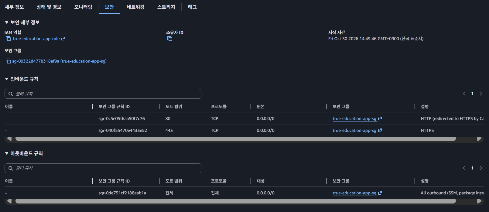

# [여울] 인프라 재구축 - Terraform·망분리·최소 권한

> velog 원문 · [원문 보기](https://velog.io/@_2_min_9_/%EC%97%AC%EC%9A%B8-%EC%9D%B8%ED%94%84%EB%9D%BC-%EC%9E%AC%EA%B5%AC%EC%B6%95-Terraform%EB%A7%9D%EB%B6%84%EB%A6%AC%EC%B5%9C%EC%86%8C-%EA%B6%8C%ED%95%9C)

## 배경 — 왜 다시 지었나

프로젝트 제출 마감 기한을 30분 앞두고, 서버 하나에 앱·DB·파일 저장소를 전부 몰아넣었다.
컨테이너 몇 개를 한 EC2 인스턴스 안에 같이 띄우고, 도메인 없이 HTTPS만 겨우 맞춘 구조였다.

발표가 안정적으로 진행되는 게 최우선이었고 그 목표는 이뤘지만, 심사에서 그 한계가 바로 드러났다.
첫 질문은 "클라우드에 어떻게 배포했는지"였다.
원래 계획은 CloudFront로 HTTPS를 받고, EC2는 앱 서버로, S3에는 학생이 그린 그림을 저장하고, DB는 망을 분리해서 따로 두는 구조였다.
하지만 마감에 쫓겨 실제로는 EC2 하나에 Docker 컨테이너를 통째로 띄웠다고 솔직히 대답했다.
정상 작동했고 비용도 효율적이었지만, 이는 시연용이었지 실사용을 고려한 구조는 아니었다.

이어서 "AWS 안에서 코어 수는 확인해봤는지" 질문을 받았다.
대답하지 못했다. 확인한 적이 없었다.

대회가 끝나고 1등을 받은 뒤, 목표가 달라졌다.
단순히 "시연이 되는 서버"가 아니라, 망분리·최소 권한·비밀 관리를 직접 경험해볼 수 있는 인프라가 필요했다.
서버 한 대에 다 몰아넣은 구조로는 이를 연습해볼 수 없었다.

그래서 Terraform으로 VPC부터 다시 지었다.

---

## 망분리 — 필요한 통로만 허용

VPC 안에 퍼블릭·프라이빗 서브넷을 나눠 뒀다.
앱 서버(EC2)는 퍼블릭 서브넷에, DB(RDS)는 프라이빗 서브넷에 둔다.
프라이빗 서브넷은 인터넷으로 나가는 길 자체가 없다.



`vpc.tf` 예시

```hcl
# 프라이빗 라우트 테이블: 인터넷으로 가는 기본 라우트(0.0.0.0/0)를 의도적으로 넣지 않음(NAT 없음).
resource "aws_route_table" "private" {
  vpc_id = aws_vpc.main.id
  tags   = { Name = "${var.project}-private-rt" }
}
```

보통 프라이빗 서브넷에서 인터넷으로 나가야 할 때는 NAT Gateway를 둔다.
[AWS 공식 요금표](https://aws.amazon.com/ko/vpc/pricing/)에 따르면 서울 리전 기준 시간당 $0.059, 한 달이면 약 43달러다.

그런데 이 프라이빗 서브넷 안에는 RDS 하나뿐이고, RDS는 아웃바운드 인터넷이 거의 필요 없다.
그래서 **NAT를 아예 만들지 않았다**.
[3번 글](03-session-store.md)에서 다룬 것과 같은 판단이다. 필요 없는 것은 만들지 않는다.

DB 쪽 보안 그룹도 들어오는 길을 하나로 좁혔다.
인터넷에서는 아예 닿을 수 없고, 앱 서버의 보안 그룹에서 오는 5432 포트만 허용한다.

`security-groups.tf` 예시

```hcl
resource "aws_security_group" "db" {
  name        = "${var.project}-db-sg"
  description = "RDS SG - allow 5432 from app server SG only"
  vpc_id      = aws_vpc.main.id

  ingress {
    description     = "PostgreSQL from app servers only"
    from_port       = 5432
    to_port         = 5432
    protocol        = "tcp"
    security_groups = [aws_security_group.app.id]
  }
}
```



IP 대역이 아니라 보안 그룹 자체를 허용 대상으로 지정했다.
앱 서버의 IP가 바뀌어도 이 규칙은 그대로 유효하고, 같은 IP 대역을 쓰는 다른 무언가가 있더라도 이 보안 그룹에 속하지 않으면 5432에 닿을 수 없다.

---

## 최소 권한 — 필요할 때마다 한 줄씩

작업용 IAM 사용자를 처음부터 넓게 만들지 않았다.
당장 필요한 권한만 주고, 막히면 그때 추가했다.

실제로 세 번 막혔다.
EC2에 IAM 역할을 붙이다가 `iam:TagInstanceProfile`이 없어서 막혔고, CloudWatch 알람에 SNS 알림을 연결하다가 `sns:*`가 없어서 막혔고, 나중에 `terraform destroy`로 전부 정리하다가 `iam:ListInstanceProfilesForRole`이 없어서 막혔다.
막힐 때마다 해당하는 권한만 정책에 추가하는 식으로 해결했다.

`terraform-user-policy.json` 예시

```json
{
  "Sid": "IamForTerraformManagedRolesOnly",
  "Effect": "Allow",
  "Action": [
    "iam:CreateRole",
    "iam:PassRole",
    "iam:CreateInstanceProfile",
    "iam:TagInstanceProfile",
    "iam:ListInstanceProfilesForRole"
  ],
  "Resource": [
    "arn:aws:iam::*:role/true-education-*",
    "arn:aws:iam::*:instance-profile/true-education-*",
    "arn:aws:iam::*:policy/true-education-*"
  ]
}
```

권한 범위도 리소스 이름으로 한정했다.
`true-education-`로 시작하는 역할·인스턴스 프로파일·정책만 건드릴 수 있고, 이 프로젝트 밖의 다른 리소스는 애초에 손댈 수 없다.

자기 권한을 스스로 넓히는 것도 막아뒀다.
새 사용자를 만들거나 자기 자신에게 권한을 추가하는 것은 명시적으로 금지했다.
이 부분은 [2번 글](02-harness-engineering.md)의 `terraform-user-policy.json` 예시 코드에서 확인할 수 있다.

---

## 비밀 관리 — 어디에도 남지 않게

RDS 비밀번호와 세션 시크릿은 내가 직접 만들지 않았다.
Terraform이 생성해서 바로 SSM Parameter Store에 `SecureString`으로 넣는다.
그 값을 내가 직접 보거나 타이핑할 일이 없다.

`secrets.tf` 예시

```hcl
resource "random_password" "session_secret" {
  length  = 64
  special = false
}

resource "aws_ssm_parameter" "session_secret" {
  name  = "/${var.project}/session-secret"
  type  = "SecureString"
  value = random_password.session_secret.result
}
```



앱 서버도 이 값을 파일로 전달받지 않는다.
배포 시점에 자기 IAM 역할로 Parameter Store에서 직접 가져간다.
그 역할이 읽을 수 있는 것은 이 프로젝트 경로뿐이다.

```hcl
resource "aws_iam_role_policy" "app_ssm_parameters" {
  name = "${var.project}-app-ssm-parameters"
  role = aws_iam_role.app.id

  policy = jsonencode({
    Statement = [
      {
        Effect   = "Allow"
        Action   = ["ssm:GetParameter", "ssm:GetParameters"]
        Resource = "arn:aws:ssm:${var.aws_region}:*:parameter/${var.project}/*"
      }
    ]
  })
}
```



그래서 **비밀값이 채팅·명령어·로그에는 남지 않는다.**
배포 아카이브를 옮길 때도 마찬가지다.
코드만 올리고, 비밀값은 서버가 자기 역할로 그 자리에서 가져와 조립한다.

다만 찾아보니, 원격 백엔드 없이 로컬에 둔 `terraform.tfstate`에는 이 값이 그대로 평문으로 남는다고 한다.
이번에는 이 파일을 따로 암호화하거나 보호하지 않았다.

---

## 접속 — 열쇠 없이

EC2 인스턴스에 키 페어를 아예 만들지 않았다.
보안 그룹에도 22번 포트가 없다. SSH로 들어갈 방법 자체가 없다.





`ec2.tf` 예시

```hcl
resource "aws_instance" "app" {
  ami                         = data.aws_ami.ubuntu.id
  instance_type               = var.app_instance_type
  subnet_id                   = aws_subnet.public[0].id
  vpc_security_group_ids      = [aws_security_group.app.id]
  iam_instance_profile        = aws_iam_instance_profile.app.name
  associate_public_ip_address = true

  metadata_options {
    http_tokens = "required" # IMDSv2 강제
  }
}
```

코드를 확인해보면 `key_name`이 없다.
접속은 SSM Session Manager로만 한다.
인스턴스 역할에 AWS 관리형 정책 하나만 붙이면 된다.

```hcl
resource "aws_iam_role_policy_attachment" "app_ssm" {
  role       = aws_iam_role.app.name
  policy_arn = "arn:aws:iam::aws:policy/AmazonSSMManagedInstanceCore"
}
```

이 정책만 있으면 AWS 콘솔이나 CLI에서 `aws ssm start-session`으로 바로 터미널이 열린다.
개인 키를 만들고 보관하고 잃어버리지 않게 관리할 일 자체가 없다.
접속 권한도 키 파일이 아니라 AWS IAM 권한 하나로 통제된다.

메타데이터 서비스도 IMDSv2로 강제해뒀다(`http_tokens = "required"`).
토큰 없이 메타데이터를 그냥 읽어가는 구버전 방식은 막았다.

---

## 마무리

심사에서 하지 못했던 대답을, 몇 달 뒤 혼자 Terraform으로 채워나갔다.

망분리도, 최소 권한도, 비밀 관리도, 접속 방식도 결국 같은 질문으로 돌아가는 것 같다.
지금 이것이 꼭 필요한가, 필요하다면 얼마나 좁게 열어둘 수 있는가.
NAT를 안 만든 것도, 권한을 그때그때 한 줄씩 추가한 것도, 비밀값을 서버가 직접 가져가게 한 것도, 열쇠 파일 대신 IAM으로 접속을 통제한 것도 전부 같은 질문에서 나온 선택이었다.

다음 글에서는 이 인프라를 실제로 무너뜨려본다.
백업을 만드는 것과, 그것으로 복구할 수 있는지 확인하는 것은 다른 일이었다.
