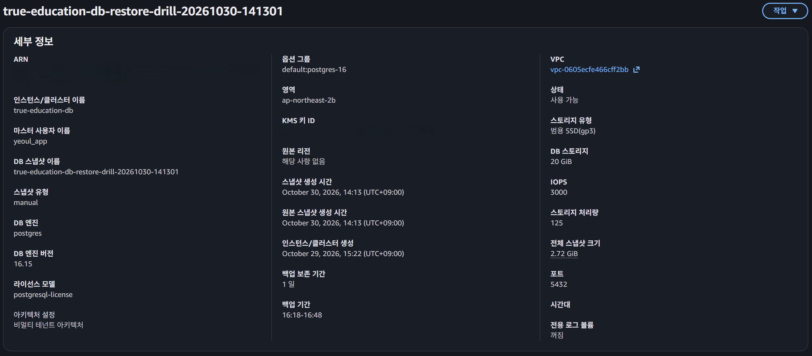

# [여울] 알고 있던 것과 지킨 것의 차이 - 백업 공백, RTO 실측

> velog 원문 · [원문 보기](https://velog.io/@_2_min_9_/%EC%97%AC%EC%9A%B8-%EC%95%8C%EA%B3%A0-%EC%9E%88%EB%8D%98-%EA%B2%83%EA%B3%BC-%EC%A7%80%ED%82%A8-%EA%B2%83%EC%9D%98-%EC%B0%A8%EC%9D%B4-%EB%B0%B1%EC%97%85-%EA%B3%B5%EB%B0%B1-RTO-%EC%8B%A4%EC%B8%A1)

백업이 중요하다는 것은 당연히 알고 있었다.
2026년 10월 1일, `pg_dump`로 DB 전체를 로컬에 떠둔 적도 있었다.

문제는 그 다음이었다.
그 사이 학생들은 책을 두 권 더 완성했는데, 10월 3일 EC2 인스턴스와 Elastic IP, 보안 그룹까지 전부 지우면서 "백업이 있으니 괜찮다"고만 생각했다.
그 백업은 이틀 전 것이었다.

재구축하며 복원해보고 나서야 알았다.
10월 1일부터 3일 사이, 책 두 권 분량의 기록이 통째로 빠져 있었다. 유실이 아니라 애초에 백업되지 않은 구간이었다.

백업이 중요한 것을 몰랐던 것이 아니라, 서버를 내리는 그 순간에 다시 뜨지 않았을 뿐이다.
알고 있는 것과 그 순간에 지키는 것은 달랐다.

이번 재구축에서는 지난 순간의 실수를 그냥 넘기지 않고, 백업을 뜨는 것과 그 백업으로 실제로 복구할 수 있는지 확인하는 것 둘 다 직접 해보고 시간까지 재기로 했다.

---

## RPO — 잃어도 되는 시간의 길이

이 사고를 재해 복구 용어로 바꾸면 **RPO(Recovery Point Objective)** 문제다.
RPO는 "장애가 나도 괜찮은, 가장 최근 백업까지의 간격"을 뜻한다.
백업을 매일 뜨면 RPO는 하루, 아예 안 뜨면 RPO는 정해지지 않은 채로 계속 커진다.

1차 배포에는 정해진 백업 주기가 없었다.
생각날 때 수동으로 `pg_dump`를 떴을 뿐이고, 공교롭게도 10월 1일 이후로는 한 번도 뜨지 않았다.
그 구간의 RPO는 사실상 무한이었던 것이다.

재구축에서는 RDS의 자동 백업을 켜 최소한의 주기를 만들어뒀다.
보존 기간은 원래 7일로 두려 했는데, 무료 평가판 계정 제한에 걸려 1일로 낮췄다.
하지만 백업 주기를 정하는 것과, 그 백업으로 실제로 얼마나 빨리 복구되는지를 아는 것은 또 다른 문제였다.

다음은 그 실측 기록이다.

---

## 복구 드릴 — 시간 측정

이번에는 "스냅샷이 있다"에서 멈추지 않고, 실제로 복구까지 해보고 시간을 쟀다.

먼저 수동 스냅샷을 만들었다(`true-education-db-restore-drill-20261030-141301`).
생성에 걸린 시간은 4분 37초였다.

그 스냅샷으로 새 RDS 인스턴스(`true-education-db-restore-test`)를 복구했다.
여기 걸린 시간이 **RTO(Recovery Time Objective)**, 장애가 났을 때 서비스가 다시 살아나기까지 걸리는 시간이다.
7분 19초가 걸렸다.

"RDS는 복구가 쉽다"는 말과 "복구에 7분 19초 걸린다"는 말은 전혀 다른 수준의 근거다.

---

## 검증 — 상태만 보고 끝내지 않기

RDS 콘솔에서 "사용 가능" 상태만 보고 끝내지 않았다.
상태와 실제 데이터는 다른 문제라, EC2에서 SSM으로 접속해 복구된 인스턴스에 직접 `psql`로 붙었다.

`students`·`books`·`book_assignments` 행 수를 세어봤다.
10·6·12, 원본과 정확히 같았다.

학생 이름까지 조회해 실제 값이 들어있는지도 확인했다.

검증이 끝난 뒤 복구 테스트용 인스턴스는 바로 지웠다.
드릴에 쓴 수동 스냅샷만 남겨뒀는데, 스토리지 비용이 거의 들지 않아서이다.

---

## 한계

찾아보니, 진짜 복구 검증은 여기서 끝나지 않는다고 한다.
스냅샷에서 인스턴스를 복구하는 것뿐 아니라, 앱이 보는 `DATABASE_URL`을 그 인스턴스로 바꾸고 서비스가 실제로 요청을 받는지까지 확인해야 완전한 복구 드릴이라는 게 정설이었다.

이번에는 거기까지 하지 못했다.
이번이 AWS를 체계적으로 써본 첫 연습이라, 스냅샷 생성·복구·데이터 검증 같은 핵심 기능 위주로 범위를 좁혀 진행했다.

검증이 끝나자마자 테스트 인스턴스를 지웠고, `DATABASE_URL` 전환은 다음 숙제로 남겨뒀다.

---

## 마무리

이번 드릴로 알게 된 것은 두 가지다.
백업 주기가 없으면 RPO는 무한이 된다. 그리고 복구에 얼마나 걸리는지 모르면, 안전망을 제대로 설계했다고 할 수 없다.

다음 글에서는 이 새 인프라에 처음 배포하면서 만난 프로덕션 버그 세 개를 다룬다.
