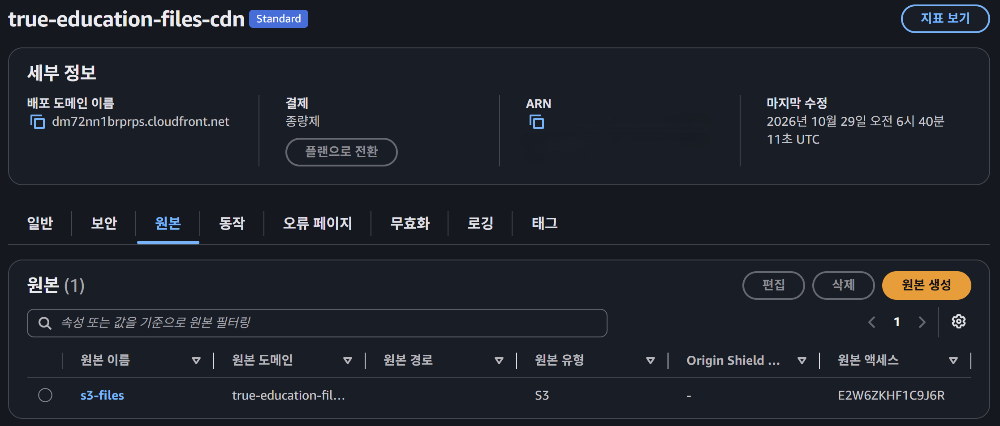
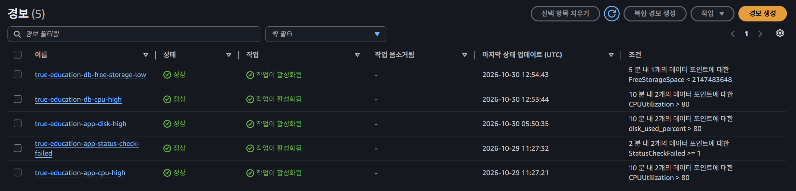

# [여울] 의도치 않은 사고 발생 - Elastic IP·Terraform 드리프트·알람 버그

## 배경 — 디스크 사용률 알람 하나 추가하려다

CloudWatch에 디스크 사용률 알람을 추가하기로 했다.
EC2 기본 지표에는 디스크 사용량이 없어서, CloudWatch 에이전트를 설치해야 했다.

에이전트 설치 스크립트를 `ec2.tf`의 `user_data`에 추가하고 `terraform apply`를 돌렸다.

인스턴스를 통째로 새로 만들진 않았다(`user_data_replace_on_change = false`로 막아뒀기 때문이다). 하지만 Terraform은 바뀐 `user_data`를 적용하기 위해 인스턴스를 재부팅시켰다.

이는 단순히 재부팅 한 번으로 끝날 일이 아니었다.

---

## 사고 1 — Elastic IP를 안 쓴 대가

EC2에 탄력적 IP(Elastic IP)를 붙이지 않았다.
리소스 하나를 덜 만드는 쪽을 택했고, 임시 공인 IP만으로 충분하다고 판단했었다.

재부팅 한 번으로 이 판단의 대가가 바로 드러났다.
공인 IP가 `3.35.156.117`에서 `15.165.77.117`로 바뀌었다.

컨테이너는 `restart: unless-stopped`로 알아서 다시 떴다.
문제는 `SITE_ADDRESS`였다.
이 주소는 sslip.io 방식이라 IP를 그대로 담고 있었고, Caddy가 발급받는 인증서 도메인과 백엔드 CORS_ORIGIN이 전부 이 값을 보고 있었다.

바뀐 IP로 `SITE_ADDRESS`를 수동으로 갱신하고 컨테이너를 재생성한 뒤에야 사이트가 다시 열렸다.

---

## 사고 2 — Terraform apply 중단과 드리프트

S3와 CloudFront로 파일 저장소를 만들던 중, 와이파이가 끊겼다.
`terraform apply`를 강제로 종료할 수밖에 없었다.

문제는 타이밍이었다.
CloudFront 배포 생성 요청은 이미 AWS에 도달한 뒤였다.
실제로는 리소스가 만들어졌는데, 그 결과를 기록해야 할 `terraform.tfstate`에는 아무것도 남지 않았다.
AWS에 있는 실제 상태와 Terraform이 알고 있는 상태가 어긋나는 이러한 상황을 **드리프트**라고 한다.

그때 AWS 콘솔에서 직접 확인한 CloudFront 배포 화면이다.
Terraform은 이 리소스의 존재를 전혀 모르는 상태였다.

`terraform plan`을 돌리면 이 CloudFront를 다시 만들려고 시도할 상황이었다.
`terraform import`로 이미 만들어진 리소스를 `state`에 가져온 뒤, `plan`에서 변경 사항이 없는 것을 확인하고 나서야 나머지 작업을 이어갔다.

---

## 사고 3 — 계속 비어있던 CloudWatch 알람

RDS CPU·스토리지 알람 2개가 계속 데이터 없음(INSUFFICIENT_DATA) 상태였다.
알람을 만들 때 지정하는 차원(dimension) 하나가 잘못돼 있었다.

`aws_db_instance.id`를 넣어뒀는데, CloudWatch가 RDS 지표를 찾을 때 보는 값은 `.identifier`였다.
두 값이 다르다는 것을 알아채지 못하고 그대로 뒀다.

차원을 `.identifier`로 바꾸자 알람이 정상적으로 데이터를 받기 시작했다.
아래 사진은 수정한 뒤 확인한 알람 목록이다.
RDS 관련 알람 두 개를 포함해 5개 전부 정상 상태로 돌아와 있다.

---

## 마무리

세 사고 모두 작은 선택에서 시작됐다.
Elastic IP를 안 만든 것, 끊긴 apply를 바로 확인하지 않은 것, 차원 하나를 잘못 넣은 것.
전부 작업할 때는 사소해 보였다.

재부팅 한 번이 그중 하나를 바로 드러냈고, 나머지 둘은 다른 시점에 따로 드러났다.
공통점은 셋 다 당장은 몰랐다가, 나중에 직접 겪고 나서야 알게 됐다는 것이다.

대회 코드 리뷰부터 인프라 재구축까지, 돌아보면 전부 같은 질문으로 돌아갔다.
지금 이것이 진짜 맞는지, 가정이 아니라 직접 확인했는가.
열 편을 쓰면서 배운 것은 결국 그 확인하는 습관이었다.

여울 프로젝트를 돌아보는 글은 이것으로 마친다.
